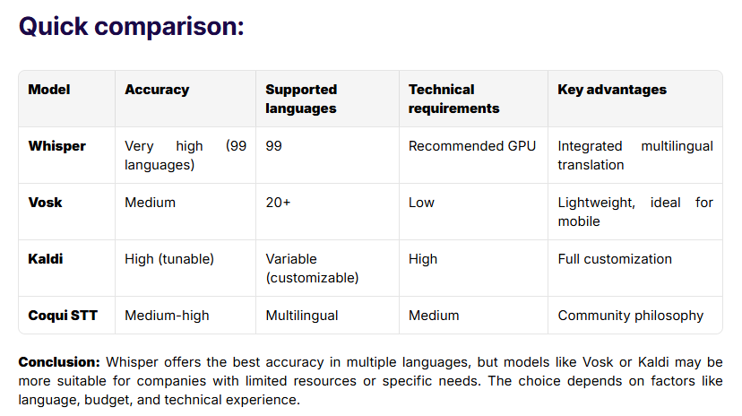

## Le principal inconvénient de Whisper est sans doute sa lenteur à transcrire l'audio en texte. Cependant, d'après mon expérience, **ses résultats sont supérieurs à ceux des modèles Vosk ou Kaldi** . Il a été entraîné sur plus de 680 000 heures d'enregistrements multilingues couvrant divers sujets et accents

