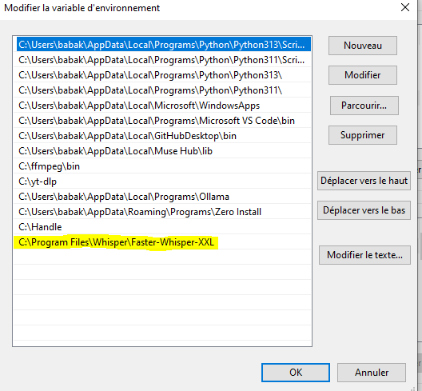

# 🎙️ Faster-Whisper-XXL – Manuel complet

## 🧭 Sommaire

* [1️⃣ Introduction et contexte]()
* [2️⃣ Installation &amp; configuration]()
* [3️⃣ Commande parfaite (usage anime japonais)]()
* [4️⃣ Script Python automatisé]()
* [5️⃣ Liste complète des arguments (classée par thème)]()
  * [⚙️ Configuration générale]()
  * [🧠 Tâches &amp; langues]()
  * [🔍 Décodage &amp; génération]()
  * [🎧 VAD – Voice Activity Detection]()
  * [🧹 Filtres audio (pré-traitement)]()
  * [✂️ Segmentation &amp; affichage texte]()
  * [👥 Diarization (multi-locuteurs)]()
  * [🧪 Fonctions avancées]()
  * [🗂️ Formats &amp; sorti]()

---

## 🎬 1. Introduction

**Faster-Whisper-XXL** (r245.4) est une version optimisée de *Whisper* pour Windows, développée par **Purfview (Const-me)**. Elle inclut :

- des améliorations de vitesse (CUDA / CPU optimisé)
- des filtres audio internes (nettoyage, amplification, coupe silencieuse)
- un VAD intégré pour détection automatique de la parole
- un support multi-langue et traduction directe (ex: japonais → anglais)

GitHub officiel : [https://github.com/Purfview/whisper-standalone-win](https://github.com/Purfview/whisper-standalone-win)

Releases : [https://github.com/Purfview/whisper-standalone-win/releases](https://github.com/Purfview/whisper-standalone-win/releases)

---

## ⚙️ 2. Installation & Configuration



puis redémarre l'ordu

1. **Télécharge** la dernière version dans **github.com/Purfview/whisper-standalone-win/releases**
2. **Va dans** C:\Program Files\Whisper\Faster-Whisper-XXL
3. Télécharger tes modèles Whisper (`medium`, `large-v3`, etc.) dans : **Whisper\Purfview-Whisper-Faster_models\**
4. Où les télécharger:**huggingface.co/Systran(**faster whisper**)**
5. Assure-toi que le dossier de sortie existe (ex : `C:\Anime\Subs`).

---

## 💡 3. Commande parfaite pour ton usage

```bash
faster-whisper-xxl.exe "C:/Users/babak/Music/VideoProc Converter AI/29V2.mp4" `
--model large-v3-turbo `
--language ja `
--japanese blend `
--output_format srt `
--output_dir "C:/Users/babak/Documents/Transcriptions" `
--vad_filter True `
--vad_method silero_v5_fw `
--max_gap 0.1 `
--vad_speech_pad_ms 200 `
--sentence `
--standard_asia `
--word_timestamps True `
--ignore_dupe_prompt 2 `
--hallucination_silence_threshold 4 `
--v3_offsets_off `
--threads 4 `
--print_progress `
--batched `
```

Cette commande est optimisée pour :

- 🎙️ **traduction japonaise** → anglais
- ✂️ **coupure si pause > 0.10 s**
- 🧹 **nettoyage & amplification audio**
- 💬 **sortie claire (.srt)**
- 💫 **meilleure précision et synchronisation**

| **Argument**                              | **Catégorie** | **Valeur**    | **Rôle Condensé et Explication**                                                                                                                             |
| ----------------------------------------------- | -------------------- | ------------------- | -------------------------------------------------------------------------------------------------------------------------------------------------------------------- |
| **Chemin du Fichier**                     | Positionnel          | `C:/.../29V2.mp4` | Le fichier audio/vidéo à transcrire.**Argument requis.**                                                                                                     |
| **`--model`**                           | Modèle              | `large-v3-turbo`  | Utilise le**modèle le plus grand et le plus précis**(V3 optimisé) pour la transcription.                                                                    |
| **`--language`**                        | Langue               | `ja`              | **Langue source Japonaise**pour guider le modèle.                                                                                                             |
| **`--output_format`**                   | Sortie               | `srt`             | Format de sous-titres le plus courant.                                                                                                                               |
| **`--output_dir`**                      | Sortie               | Dossier             | Dossier de destination pour le fichier `.srt`.                                                                                                                     |
| ---                                             | ---                  | ---                 | ---                                                                                                                                                                  |
| **`--vad_filter`**                      | VAD                  | `True`            | **Active la détection de voix**(VAD) pour ignorer les silences et améliorer la vitesse/précision.                                                           |
| **`--vad_method`**                      | VAD                  | `silero_v5_fw`    | Utilise la**méthode Silero V5**(la plus récente/performante) pour la détection de parole.<br />Mais il y a plein de cas ou  silero_v4_fw est bien meilleur |
| **`--vad_speech_pad_ms`**               | VAD                  | `200`             | Ajoute**200 ms**de protection autour des paroles détectées pour ne pas couper les mots.                                                                      |
| ---                                             | ---                  | ---                 | ---                                                                                                                                                                  |
| **`--threads`**                         | Performance          | `4`               | Utilise 4 cœurs CPU pour les tâches non-GPU.                                                                                                                       |
| **`--batched`**                         | Performance          | **Flag**      | **Active le traitement par lots**des segments pour une accélération significative (souvent x2 à x8).                                                        |
| **`--print_progress`**                  | Affichage            | **Flag**      | Affiche une**barre de progression**claire au lieu du texte segment par segment.                                                                                |
| ---                                             | ---                  | ---                 | ---                                                                                                                                                                  |
| **`--sentence`**                        | Formatage            | **Flag**      | Force la**coupure des segments en phrases**complètes.                                                                                                         |
| **`--standard_asia`**                   | Formatage            | **Flag**      | Applique un préréglage de formatage**optimisé pour l'Asie**(lignes plus courtes, typiquement 16 caractères), idéal pour le japonais.                      |
| **`--word_timestamps`**                 | Formatage            | `True`            | Permet d'obtenir des**horodatages précis au niveau du mot** , essentiel pour le formatage.                                                                    |
| **`--max_gap`**                         | Formatage            | `0.1`             | Traite les silences**plus longs que 0.1 seconde**comme une fin de phrase.                                                                                      |
| ---                                             | ---                  | ---                 | ---                                                                                                                                                                  |
| **`--japanese`**                        | Modèle              | `blend`           | Utilise le meilleur**mélange de caractères japonais**(kanji, hiragana, etc.) pour la sortie.                                                                 |
| **`--ignore_dupe_prompt`**              | Anti-Hallucination   | `2`               | Regarde les**2 segments précédents**pour éviter les répétitions (boucles d'hallucination).                                                                |
| **`--hallucination_silence_threshold`** | Anti-Hallucination   | `4`               | Aide à détecter les hallucinations en sautant les silences de**plus de 4 secondes** .                                                                        |
| **`--v3_offsets_off`**                  | Anti-Hallucination   | **Flag**      | Désactive des réglages par défaut du V3 qui pourraient causer des problèmes dans votre configuration.                                                            |

---

## 🐍 4. Script Python automatisé

```python
voir fwxxl.py
```

---

## 📖 5. Liste complète des arguments

### 🛠️ 1. Configuration Générale & Fichiers

Ces arguments définissent le modèle, le matériel, et la gestion des fichiers d'entrée/sortie.

| Argument                                                           | Description Détaillée                                                                     | Défaut          |
| ------------------------------------------------------------------ | ------------------------------------------------------------------------------------------- | ---------------- |
| **`audio [audio ...]`**                                    | Fichier(s) audio/vidéo à transcrire. (Argument positionnel)                               | -                |
| **`--model MODEL`**                                        | Nom du modèle Whisper à utiliser (ex:`medium`,`large-v3`).                            | `medium`       |
| **`--model_dir MODEL_DIR`**                                | Chemin où enregistrer/charger les fichiers du modèle.                                     | `_models`      |
| **`--device DEVICE`**                                      | Cible d'exécution pour le modèle :`cpu`,`cuda`, ou `cuda:1`pour un GPU spécifique. | `cpu`/`cuda` |
| **`--compute_type {default,auto,int8,...}`**               | Type de quantification pour l'inférence (vitesse/précision).                              | `auto`         |
| **`--output_dir OUTPUT_DIR`**                              | Répertoire pour enregistrer les fichiers de sortie.                                        | `default`      |
| **`--output_format [{json,lrc,txt,vtt,srt,tsv,all} ...]`** | Format(s) du fichier de sous-titres (accepte multiples).                                    | `['srt']`      |
| **`--verbose VERBOSE`**                                    | Afficher les messages de débogage et les journaux détaillés.                             | `False`        |
| **`--check_files`**                                        | Vérifie les fichiers d'entrée pour les erreurs avant de commencer.                        | `False`        |
| **`--beep_off`**                                           | Désactive le son "bip" à la fin de l'opération.                                          | `False`        |
| **`--version`**                                            | Affiche le numéro de version de Faster-Whisper.                                            | -                |
| **`--checkcuda`**                                          | Renvoie le nombre de périphériques CUDA (pour usage interne).                             | -                |

Exporter vers Sheets

### 🚀 2. Optimisation de la Vitesse & Traitement par Lot (Batching)

Arguments pour accélérer la transcription et traiter plusieurs fichiers/segments.

| Argument                                    | Description Détaillée                                                                                        | Défaut           |
| ------------------------------------------- | -------------------------------------------------------------------------------------------------------------- | ----------------- |
| **`--threads THREADS`**             | **Nombre de threads pour l'inférence générale (coordination, VAD, écriture).**                       | `0`(auto/4 max) |
| **`--batched`**                     | **Active le mode d'inférence par lot**(transcrit les segments VAD en parallèle).                       | `False`         |
| **`--batch_size BATCH_SIZE`**       | Taille maximale des requêtes parallèles lors de l'utilisation de `--batched`.                              | `8`             |
| **`--unmerged`**                    | (Expérimental) Utilise des segments non fusionnés en mode batch (très lent, possible meilleure précision). | `False`         |
| **`--batch_recursive`**             | **Active le traitement par lot récursif**(inclut les sous-dossiers).                                    | `False`         |
| **`--skip`**                        | Ignore le fichier si le sous-titre de sortie existe déjà.                                                    | `False`         |
| **`--print_progress`**              | Affiche une barre de progression au lieu de la transcription détaillée.                                      | `False`         |
| **`--model_preload MODEL_PRELOAD`** | Précharge le modèle avant l'itération.                                                                      | `None`          |

Sur  **CPU Intel** , donc le batch size va dépendre de  **ta puissance CPU et du nombre de cœurs réels disponibles** . Voici comment raisonner :

---

## **A. Vérifier tes cœurs**

* Sur Windows, ouvre le  **Gestionnaire des tâches → Performance → CPU** .
* Note le **nombre de cœurs physiques** (pas les threads logiques).
* Exemple : un i7 avec 8 threads = 4 cœurs physiques, 8 logiques.

---

## **B. Batch size recommandé sur CPU**

* Le batch size correspond au  **nombre de segments VAD traités en parallèle** .
* Sur CPU : **batch_size ≈ nombre de cœurs physiques** → c’est le maximum conseillé.
  * Trop petit → pas d’accélération.
  * Trop grand → surcharge, ralentissement.

Exemple :

| Cœurs physiques | batch_size conseillé                     |
| ---------------- | ----------------------------------------- |
| 2                | 2                                         |
| 4                | 4                                         |
| 6                | 6                                         |
| 8                | 8 (mais à tester, parfois 6 plus stable) |

> Note : Les threads logiques (Hyperthreading) ne doublent pas toujours la vitesse pour ce type de calcul intensif.

---

## **C. Astuce pratique**

* Commence par `--batch_size = cœurs physiques`.
* Observe l’utilisation CPU dans le gestionnaire des tâches.
  * Si utilisation < 80% → tu peux augmenter légèrement.
  * Si 100% → réduire pour éviter que le système rame.

### 🧠 3. Tâches, Langues & Pré-prompting (Contexte du Modèle)

Ces options contrôlent ce que l'IA fait et comment elle est amorcée (primée) pour la qualité.

| Argument                                      | Description Détaillée                                                                     | Défaut        |
| --------------------------------------------- | ------------------------------------------------------------------------------------------- | -------------- |
| **`--task {transcribe,translate}`**   | Opération à effectuer :**`transcribe`**(X→X) ou**`translate`**(X→Anglais).    | `transcribe` |
| **`--language {af,am,ar,as,...}`**    | Langue parlée dans l'audio.`None`pour autodétection.                                    | `None`       |
| **`--multilingual MULTILINGUAL`**     | Effectuer la détection de la langue sur chaque segment.                                    | `False`      |
| **`--language_detection_threshold`**  | Seuil de probabilité minimum pour considérer une langue comme détectée.                 | `0.5`        |
| **`--language_detection_segments`**   | Nombre de segments audio à considérer pour la détection de la langue.                    | `1`          |
| **`--initial_prompt INITIAL_PROMPT`** | Texte facultatif pour fournir un contexte (noms propres, termes techniques).                | `auto`       |
| **`--prefix PREFIX`**                 | Texte imposé comme préfixe pour le début de la première fenêtre.                       | `None`       |
| **`--hotwords HOTWORDS`**             | Mots/phrases indices pour le modèle (mots-clés à privilégier).                          | `None`       |
| **`--rehot`**                         | (Expérimental) Transfère le préréglage de prompt automatique aux routines `hotwords`. | `False`      |
| **`--condition_on_previous_text`**    | Utiliser la sortie précédente comme prompt pour la fenêtre suivante (cohérence).        | `True`       |

Exporter vers Sheets

### 🔍 4. Qualité du Décodage & Anti-Hallucination

Paramètres fins de l'algorithme d'inférence (Beam Search) et mécanismes de correction d'erreurs.

| Argument                                              | Description Détaillée                                                                              | Défaut   |
| ----------------------------------------------------- | ---------------------------------------------------------------------------------------------------- | --------- |
| **`--temperature TEMPERATURE`**               | Contrôle l'échantillonnage (créativité vs. exactitude).                                          | `0`     |
| **`--beam_size BEAM_SIZE`**                   | Nombre de faisceaux dans la recherche en faisceau (utilisé quand `temperature = 0`).              | `5`     |
| **`--best_of BEST_OF`**                       | Nombre de candidats à considérer lors de l'échantillonnage avec `temperature > 0`.              | `5`     |
| **`--patience PATIENCE`**                     | Valeur de tolérance pour la recherche en faisceau.                                                  | `2.0`   |
| **`--length_penalty LENGTH_PENALTY`**         | Pénalité de longueur du jeton (générer plus ou moins de texte).                                  | `1.0`   |
| **`--repetition_penalty REPETITION_PENALTY`** | Pénalité appliquée pour décourager la répétition des jetons.                                   | `1.0`   |
| **`--no_repeat_ngram_size`**                  | Empêche la répétition de séquences de cette taille.                                              | `0`     |
| **`--logprob_threshold LOGPROB_THRESHOLD`**   | Seuil de probabilité logarithmique moyenne. Si inférieur, le segment est considéré comme échec. | `-1.0`  |
| **`--no_speech_threshold`**                   | Seuil de silence si le décodage échoue.                                                            | `0.6`   |
| **`--compression_ratio_threshold`**           | Seuil de ratio de compression GZIP (si dépassé, souvent signe d'hallucination).                    | `2.4`   |
| **`--hallucination_silence_threshold`**       | (Expérimental) Coupe le silence long s'il y a détection d'hallucination.                           | `None`  |
| **`--hallucination_silence_th_temp`**         | Ajoute une heuristique à `--hallucination_silence_threshold`en fonction de la température.       | `1.0`   |
| **`--hallucinations_list_off`**               | Désactive la liste interne des hallucinations connues.                                              | `False` |
| **`--v3_offsets_off`**                        | Désactive les ajustements pour contrer les hallucinations du modèle `large-v3`.                  | `False` |
| **`--reprompt REPROMPT`**                     | Assure que le prompt initial est présent pour tous les segments.                                    | `True`  |
| **`--ignore_dupe_prompt IGNORE_DUPE_PROMPT`** | N'ajoute pas les répétitions au prompt.                                                            | `2`     |
| **`--prompt_reset_on_temperature`**           | Réinitialise le prompt si la température dépasse ce seuil.                                        | `0.5`   |
| **`--prompt_reset_on_no_end {0,1,2}`**        | Réinitialise le prompt si aucune fin de phrase n'est trouvée.                                      | `2`     |
| **`--temperature_increment_on_fallback`**     | Augmentation de la température si le décodage échoue.                                             | `0.2`   |
| **`--suppress_blank`**                        | Supprimer les sorties vides au début de l'échantillonnage.                                         | `True`  |
| **`--suppress_tokens SUPPRESS_TOKENS`**       | Liste des IDs de jetons à supprimer.                                                                | `-1`    |
| **`--max_new_tokens MAX_NEW_TOKENS`**         | Nombre maximal de nouveaux jetons à générer par segment.                                          | `None`  |
| **`--chunk_length CHUNK_LENGTH`**             | Longueur des segments audio pour l'encodeur.                                                         | `None`  |

Exporter vers Sheets

### 🔇 5. Traitement Audio & VAD (Découpage des Segments)

| **Méthode VAD**                | **Spécificité Principale**                 | **Avantages Clés**                                                                                             | **Inconvénients / Cas d'usage**                                                                                      |
| ------------------------------------- | -------------------------------------------------- | --------------------------------------------------------------------------------------------------------------------- | --------------------------------------------------------------------------------------------------------------------------- |
| **`silero_v5_fw`**            | **Optimisé pour FW (le plus récent)**      | Très précis sur la détection des bords de parole ; rapide.                                                         | Peut être**trop agressif**sur les silences longs ou les sons faibles (ce que vous avez expérimenté).               |
| **`silero_v4_fw`**            | **Optimisé pour FW (version précédente)** | **Plus tolérant**que le V5 ; meilleur pour les audios avec des bruits ou des faiblesses de signal (votre cas). | Légèrement moins précis sur les bords de parole que le V5.                                                               |
| **`silero_v3`/`v4`/`v5`** | **Versions "Pures" de Silero**               | Bon point de départ si les versions `_fw`échouent.                                                                | Moins bien intégrées et potentiellement plus lentes que les versions `_fw`.                                             |
| **`pyannote_v3`**             | **Diarisation et VAD**                       | Très haute précision, excellent pour les ambiances complexes et la**séparation des locuteurs**(diarisation). | **Très lourd et lent**; nécessite des jetons d'authentification (Hugging Face) pour télécharger le modèle.       |
| **`pyannote_onnx_v3`**        | **Optimisé pour ONNX (Pyannote)**           | Une version optimisée et plus rapide du `pyannote_v3`.                                                             | Reste lourd ; nécessite toujours les jetons.                                                                               |
| **`webrtc`**                  | **WebRTC VAD**                               | Très simple et**extrêmement rapide**(faible coût CPU).                                                       | Idéal pour l'audio de**téléphonie**(8kHz/16kHz) ; moins précis pour l'audio de haute qualité (musique, vidéos). |
| **`auditok`**                 | **Détection basée sur le bruit**           | Détecte les segments actifs, excellent pour les**longs enregistrements**sans parole.                           | Basé sur l'énergie du son, peut mal identifier la parole dans un environnement bruyant.                                   |

## 🏅 Classement de la Qualité VAD (Général et Contextuel)

Il n'y a pas de classement unique, car le "meilleur" dépend de l'audio. Cependant, on peut classer les méthodes selon deux critères :

### 1. Classement par **Précision/Qualité Théorique**

Ceci est le classement général pour la meilleure performance brute :

1. **Pyannote (v3 / onnx_v3)** : Offre la meilleure précision sur la détection des contours de parole, notamment quand il y a plusieurs voix.
2. **Silero V5 / V5_fw** : Très bon équilibre entre vitesse et précision sur les bords.
3. **Silero V4 / V4_fw** : Bon compromis, plus souple que le V5.
4. **Auditok / Webrtc** : Rapides, mais moins fiables pour la transcription de haute fidélité.

Départageons Auditok et Webrtc

| **Caractéristique**    | **webrtc**                                                                                                                           | **auditok**                                                                                                                                    |
| ----------------------------- | ------------------------------------------------------------------------------------------------------------------------------------------ | ---------------------------------------------------------------------------------------------------------------------------------------------------- |
| **Objectif Principal**  | Détecter la**parole humaine**(voix).                                                                                                | Détecter les**segments actifs**(parole, musique, bruit continu).                                                                              |
| **Précision**          | Très élevé et optimisé pour la voix<br /> dans le **contexte de la communication** (faible latence).                            | Précision variable ; utilise des seuils<br />basés sur l'énergie sonore<br /> pour marquer un segment comme "actif".                              |
| **Performance/Vitesse** | **Extrêmement rapide et léger** .<br /> Idéal pour une utilisation en temps réel <br />ou sur des appareils à faible puissance. | Relativement rapide, mais peut être légèrement plus lourd<br />que `webrtc`.                                                                    |
| **Cas d'Usage Idéal**  | Audio provenant de microphones, de<br />**téléphonie**(voix claire), ou<br /> lorsque la **vitesse** est la priorité.      | Découpage de très **longs fichiers audio **<br />où il faut trouver n'importe quel son qui <br />dépasse un niveau de bruit de fond constant. |
| **Inconvénients**      | Moins précis pour l'audio de**haute fidélité** ou les fréquences qui ne sont pas vocales.                                        | Plus susceptible de confondre le<br />**bruit de fond constant** <br />( ex: vent, moteur) avec de la parole.                                  |

Options de nettoyage audio (`--ff_...`) et de détection des parties parlées (VAD).

| Argument                                                                                                                                                                                                                                                                      | Description Détaillée                                                                             | Défaut          |
| ----------------------------------------------------------------------------------------------------------------------------------------------------------------------------------------------------------------------------------------------------------------------------- | --------------------------------------------------------------------------------------------------- | ---------------- |
| **`--vad_filter VAD_FILTER`**                                                                                                                                                                                                                                         | Active la détection d'activité vocale (VAD) pour filtrer les parties sans parole.                 | `True`         |
| `--vad_method {silero_v4_fw,silero_v5_fw,silero_v3,`<br /><br />Best:<br />pyannote_onnx_v3<br /><br />Note:<br />fw:**converti et optimisé** pour <br />fonctionner plus efficacement avec la librairie <br />CTranslate2 utilisée par  **Faster-Whisper** . | Méthode de détection d'activité vocale à utiliser.                                              | `silero_v4_fw` |
| **`--vad_device VAD_DEVICE`**                                                                                                                                                                                                                                         | Périphérique (`cpu`ou `cuda`) à utiliser pour l'exécution du VAD.                           | `cpu`          |
| **`--vad_threshold VAD_THRESHOLD`**                                                                                                                                                                                                                                   | Probabilités considérées comme de la parole.                                                     | `0.45`         |
| **`--vad_min_speech_duration_ms`**                                                                                                                                                                                                                                    | Durée minimale d'un segment de parole.                                                             | `250`          |
| **`--vad_max_speech_duration_s`**                                                                                                                                                                                                                                     | Durée maximale des segments de parole.                                                             | `None`         |
| **`--vad_min_silence_duration_ms`**                                                                                                                                                                                                                                   | Temps d'attente minimum de silence pour séparer un segment.                                        | `3000`         |
| **`--vad_speech_pad_ms`**                                                                                                                                                                                                                                             | Marge ajoutée au début et à la fin de chaque segment de parole.                                  | `900`          |
| **`--vad_window_size_samples`**                                                                                                                                                                                                                                       | Taille des échantillons audio pour le modèle VAD.                                                 | `1536`         |
| **`--vad_dump`**                                                                                                                                                                                                                                                      | Sauvegarde les timings VAD et divers fichiers audio intermédiaires.                                | `False`        |
| **`--vad_dump_aud`**                                                                                                                                                                                                                                                  | Sauvegarde les segments audio collectés par le VAD.                                                | `False`        |
| **`--clip_timestamps CLIP_TIMESTAMPS`**                                                                                                                                                                                                                               | Liste d'horodatages `start,end,start,end,...`(en secondes) pour ne traiter que certaines parties. | `0`            |
| **`--ff_track {1,2,3,4,5,6}`**                                                                                                                                                                                                                                        | Sélectionne la piste audio à traiter.                                                             | `1`            |
| **`--ff_dump`**                                                                                                                                                                                                                                                       | Sauvegarde l'audio pré-traité par les filtres.                                                    | `False`        |
| **`--ff_fftdn [0 - 97]`**                                                                                                                                                                                                                                             | Filtre audio : Dénouage général par Transformée de Fourier Rapide.                              | `0`            |
| **`--ff_rnndn_xiph`**                                                                                                                                                                                                                                                 | Filtre audio : Suppression du non-vocal par modèle RNN Xiph (moins agressif).                      | `False`        |
| **`--ff_rnndn_sh`**                                                                                                                                                                                                                                                   | Filtre audio : Suppression du non-vocal par modèle RNN SH (agressif).                              | `False`        |
| **`--ff_vocal_extract {mdx_kim2}`**                                                                                                                                                                                                                                   | Filtre audio : Extraction des voix (séparation des instruments/fond sonore).                       | `None`         |
| **`--ff_loudnorm`**                                                                                                                                                                                                                                                   | Filtre audio : Normalisation de l'intensité sonore EBU R128.                                       | `False`        |
| **`--ff_speechnorm`**                                                                                                                                                                                                                                                 | Filtre audio : Amplification de la parole.                                                          | `False`        |
| **`--ff_tempo [0.5 - 2.0]`**                                                                                                                                                                                                                                          | Filtre audio : Ajuste le tempo de l'audio.                                                          | `1.0`          |
| **`--ff_gate`**                                                                                                                                                                                                                                                       | Filtre audio : Réduit les parties inférieures d'un signal (noise gate).                           | `False`        |
| **`--ff_lowhighpass`**                                                                                                                                                                                                                                                | Filtre audio : Passe-bande 50Hz - 7800Hz.                                                           | `False`        |
| **`--ff_silence_suppress noise duration`**                                                                                                                                                                                                                            | Filtre audio : Supprime les parties silencieuses.                                                   | `[0, 3.0]`     |
| **`--ff_mp3`**                                                                                                                                                                                                                                                        | Filtre audio : Conversion vers MP3 et retour (peut corriger certains problèmes).                   | `False`        |
| **`--ff_sync`**                                                                                                                                                                                                                                                       | Filtre audio : Étire/comprime les échantillons selon les horodatages.                             | `False`        |
| **`--ff_fc`**                                                                                                                                                                                                                                                         | Sélectionne uniquement le canal avant-centre (FC).                                                 | `False`        |
| **`--ff_lc`**                                                                                                                                                                                                                                                         | Sélectionne uniquement le canal gauche.                                                            | `False`        |
| **`--ff_invert`**                                                                                                                                                                                                                                                     | Inverse la polarité du canal gauche et mixe en mono.                                               | `False`        |
| **`--mdx_chunk MDX_CHUNK`**                                                                                                                                                                                                                                           | Taille des morceaux pour le filtre `mdx_kim2`.                                                    | `15`           |
| **`--voc_device VOC_DEVICE`**                                                                                                                                                                                                                                         | Périphérique à utiliser pour le filtre d'extraction vocale.                                      | `cpu`          |

Exporter vers Sheets

### 👥 6. Diarization (Multi-Locuteurs)

Arguments pour la détection et l'identification des différents locuteurs.

| Argument                                        | Description Détaillée                                                 | Défaut     |
| ----------------------------------------------- | ----------------------------------------------------------------------- | ----------- |
| **`--diarize {pyannote_v3.0, ...}`**    | Active la diarisation (identification des locuteurs).                   | `None`    |
| **`--diarize_device DIARIZE_DEVICE`**   | Périphérique (`cpu`ou `cuda`) à utiliser pour la diarisation.    | `cpu`     |
| **`--diarize_threads DIARIZE_THREADS`** | Nombre de threads pour la diarisation.                                  | `0`(auto) |
| **`--diarize_dump`**                    | Sauvegarde la sortie de la diarisation dans un fichier.                 | `False`   |
| **`--diarize_only`**                    | Effectue uniquement la diarisation sans transcription.                  | `False`   |
| **`--diarize_ff DIARIZE_FF`**           | Active la diarisation après les filtres audio (`--ff_...`).          | `None`    |
| **`--speaker SPEAKER`**                 | Chaîne de caractères à utiliser au lieu de "SPEAKER" dans la sortie. | `SPEAKER` |
| **`--num_speakers NUM_SPEAKERS`**       | Nombre fixe de locuteurs.                                               | `None`    |
| **`--min_speakers MIN_SPEAKERS`**       | Nombre minimum de locuteurs à rechercher.                              | `None`    |
| **`--max_speakers MAX_SPEAKERS`**       | Nombre maximum de locuteurs à rechercher.                              | `None`    |
| **`--return_embeddings`**               | Sauvegarde les vecteurs vocaux du modèle de diarisation.               | `False`   |

Exporter vers Sheets

### ✂️ 7. Formatage du Texte & Segmentation des Sous-Titres

Règles pour le découpage des lignes, la gestion de la ponctuation et l'horodatage.

| Argument                                        | Description Détaillée                                                                              | Défaut                      |
| ----------------------------------------------- | ---------------------------------------------------------------------------------------------------- | ---------------------------- |
| **`--sentence`**                        | Active la coupure des lignes par phrase (chaque phrase commence un nouveau segment).                 | `False`                    |
| **`--standard`**                        | Préréglage rapide pour le format standard occidental.                                              | `False`                    |
| **`--standard_asia`**                   | Préréglage rapide pour le format standard asiatique.                                               | `False`                    |
| **`--max_line_width MAX_LINE_WIDTH`**   | Nombre maximal de caractères dans une ligne avant de la couper.                                     | `1000`                     |
| **`--max_line_count MAX_LINE_COUNT`**   | Nombre maximal de lignes dans un segment de sous-titre.                                              | `1`                        |
| **`--max_comma MAX_COMMA`**             | (Nécessite `--sentence`) Après cette longueur, une virgule est traitée comme une fin de phrase. | `250`                      |
| **`--max_comma_cent {20,30,...100}`**   | Pourcentage de `--max_line_width`où la ligne est coupée après une virgule.                      | `100`                      |
| **`--max_gap MAX_GAP`**                 | Seuil pour une longueur d'écart (en secondes) traitée comme une fin de segment.                    | `3.0`                      |
| **`--min_dist_to_end {0,4,5,...}`**     | Distance minimale à la fin de ligne pour les mots de liaison.                                       | `0`                        |
| **`--prepend_punctuations`**            | Symboles de ponctuation à fusionner avec le mot**suivant** .                                  | `'“¿([{-`                |
| **`--append_punctuations`**             | Symboles de ponctuation à fusionner avec le mot**précédent** .                              | `".。,，!！?？:：”)]}、"` |
| **`--word_timestamps WORD_TIMESTAMPS`** | Extrait les horodatages au niveau du mot.                                                            | `True`                     |
| **`--highlight_words HIGHLIGHT_WORDS`** | Souligne chaque mot au fur et à mesure (mode karaoké).                                             | `False`                    |
| **`--without_timestamps`**              | Génère du texte sans horodatage.                                                                   | `None`                     |
| **`--max_initial_timestamp`**           | L'horodatage initial ne peut pas être postérieur à cette valeur (en secondes).                    | `1.0`                      |
| **`--japanese {blend,kanji,...}`**      | Permet d'orienter le style d'écriture du japonais.                                                  | `blend`                    |
| **`--one_word {0,1,2}`**                | Sortie de sous-titres avec un mot par ligne.                                                         | `0`                        |
| **`--postfix`**                         | Ajoute le code de la langue en suffixe au nom du fichier de sous-titres.                             | `False`                    |
| **`--alt_writer_off`**                  | (Expérimental) Désactive le writer alternatif des sous-titres.                                     | `False`                    |

---

## 🟢Argments donnés par le help de faster-whisper-xxl.exe

# 🧠  Paramètres essentiels

| Option          | Valeur         | Description                                          |
| --------------- | -------------- | ---------------------------------------------------- |
| `--model`     | nom du modèle | Modèle Whisper à utiliser (ex :`large-v3-turbo`) |
| `--model_dir` | chemin         | Utilise un dossier local contenant déjà un modèle |
| `audio`       | fichier        | Le fichier audio/vidéo à transcrire                |

Exporter vers Sheets

---

# 📤 3. Options de sortie

| Option                   | Valeur possible          | Description                                              |
| ------------------------ | ------------------------ | -------------------------------------------------------- |
| `--output_dir`         | dossier                  | Dossier où seront enregistrés les fichiers SRT/VTT/TXT |
| `--output_format`      | srt, vtt, txt, json, all | Format(s) de sortie désiré(s)                          |
| `--verbose`            | 0/1/2                    | Niveau de détails dans les logs                         |
| `--task`               | transcribe / translate   | Transcription ou traduction directe                      |
| `--timestamps`         | —                       | Affiche les timestamps (par défaut)                     |
| `--without_timestamps` | —                       | Désactive les timestamps                                |

Exporter vers Sheets

---

# 🌍 4. Langue

| Option         | Valeur      | Description                               |
| -------------- | ----------- | ----------------------------------------- |
| `--language` | code langue | Force la langue (ex :`ja`pour japonais) |
| `--lang`     | 1/2         | Mode langue avancé (Purfview)            |

Exporter vers Sheets

---

# ⚙️ 5. Matrice de calcul / vitesse

| Option             | Valeur                        | Description                             |
| ------------------ | ----------------------------- | --------------------------------------- |
| `--compute_type` | float32, int8, auto, bfloat16 | Précision et vitesse                   |
| `--threads`      | nombre                        | Nombre de threads CPU                   |
| `--beam_size`    | nombre                        | Augmente précision mais ralentit       |
| `--best_of`      | nombre                        | Teste plusieurs propositions de phrases |

---

# 🔊 6. VAD (Détection de voix)

| Option                            | Valeur                                                          | Description                                          |
| --------------------------------- | --------------------------------------------------------------- | ---------------------------------------------------- |
| `--vad_method`                  | silero_v4, silero_v5, silero_v5_fw, webrtc, auditok, pyanote_v3 | Choix du moteur VAD (silero_v5_fw = le plus récent) |
| `--vad_filter`                  | —                                                              | Active le filtrage par VAD                           |
| `--vad_threshold`               | 0 → 1                                                          | Sensibilité (bas = plus sensible)                   |
| `--vad_min_speech_duration_ms`  | ms                                                              | Durée minimale d’un segment vocal                  |
| `--vad_max_speech_duration_s`   | sec                                                             | Durée maximale d’un segment                        |
| `--vad_min_silence_duration_ms` | ms                                                              | Silence minimal pour couper                          |
| `--vad_speech_pad_ms`           | ms                                                              | Padding avant/après un segment                      |
| `--vad_window_size_samples`     | taille                                                          | Longueur de la fenêtre d’analyse                   |
| `--vad_device`                  | cpu / cuda                                                      | Matériel utilisé pour VAD                          |

Exporter vers Sheets

---

# 🎵 7. Options audio avancées

| Option              | Description                          |
| ------------------- | ------------------------------------ |
| `--ffmpeg`        | Utilise ffmpeg interne               |
| `--audio_filters` | Filtres audio FFmpeg                 |
| `--ff_dump`       | Enregistre les segments extraits     |
| `--ff-cuda`       | Accélération CUDA FFmpeg           |
| `--ff`            | Mode audio FFmpeg spécial           |
| `--f-crop`        | Coupe automatique les silences/bords |

Exporter vers Sheets

---

# 📝 8. Prompting / contrôle du texte

| Option                   | Description                                   |
| ------------------------ | --------------------------------------------- |
| `--initial_prompt`     | Ajoute un prompt pour guider la transcription |
| `--prefix`             | Préfixe imposé                              |
| `--postfix`            | Postfix imposé                               |
| `--ignore_dupe_prompt` | Ignore les prompts répétés                 |
| `--reprompt`           | Répète prompt si bloc incohérent           |

Exporter vers Sheets

---

# 🕒 9. Gestion des timestamps

| Option                      | Valeur | Description                      |
| --------------------------- | ------ | -------------------------------- |
| `--max_initial_timestamp` | s      | Décalage max du 1er timestamp   |
| `--timestamps_format`     | format | Format des timestamps            |
| `--timestamps_threshold`  | float  | Sensibilité pour les timestamps |
| `--word_timestamps`       | —     | Timestamps par mot               |
| `--highlight_words`       | —     | Coloration mot par mot           |

Exporter vers Sheets

---

# 🧩 10. Japonais (options Purfview)

| Option         | Valeur                               | Description                         |
| -------------- | ------------------------------------ | ----------------------------------- |
| `--japanese` | blend / kanji / hira / hira+katakana | Méthode de transcription japonaise |
| `--one_word` | 0/1/2                                | Force la sortie en un seul mot      |
| `--sentence` | 0/1                                  | Découpe par phrase                 |
| `--standard` | —                                   | Mode standard japonais              |

Exporter vers Sheets

---

# 🗣️ 11. Diarisation (séparation des voix)

| Option                  | Description                                    |
| ----------------------- | ---------------------------------------------- |
| `--diarize`           | Active la diarisation (pyannote, reverb, etc.) |
| `--num_speakers`      | Force un nombre de locuteurs                   |
| `--min_speakers`      | Minimum                                        |
| `--max_speakers`      | Maximum                                        |
| `--diarize_only`      | Sort uniquement la diarisation                 |
| `--return_embeddings` | Retourne les embeddings vocaux                 |
