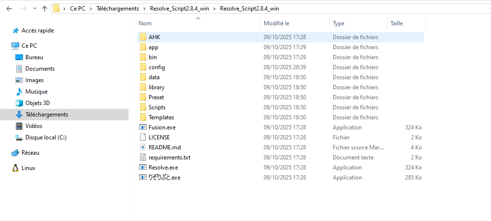
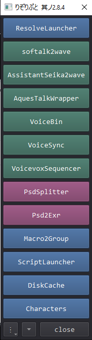
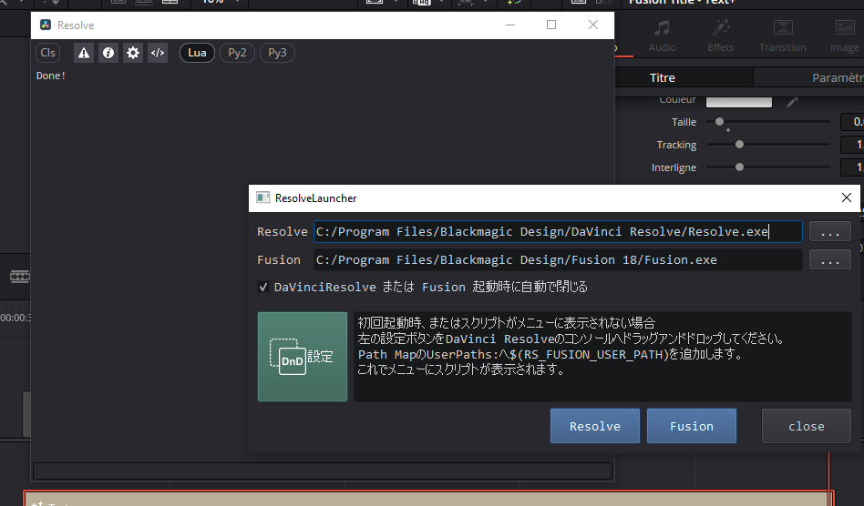
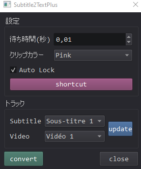
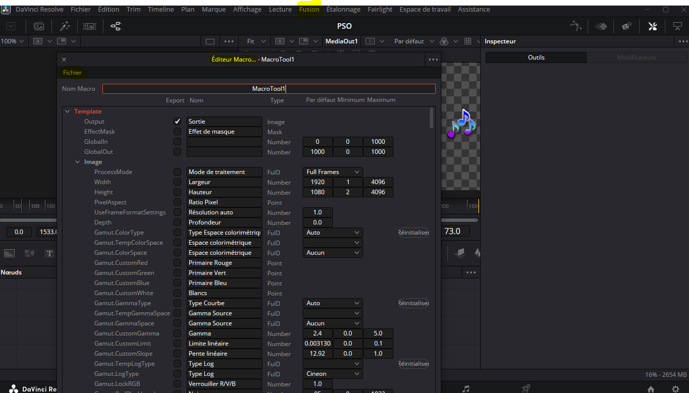
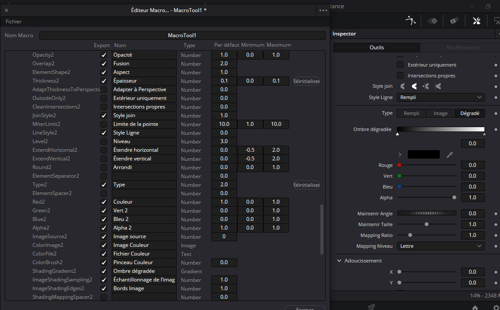
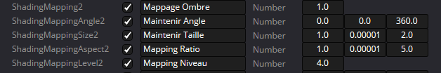
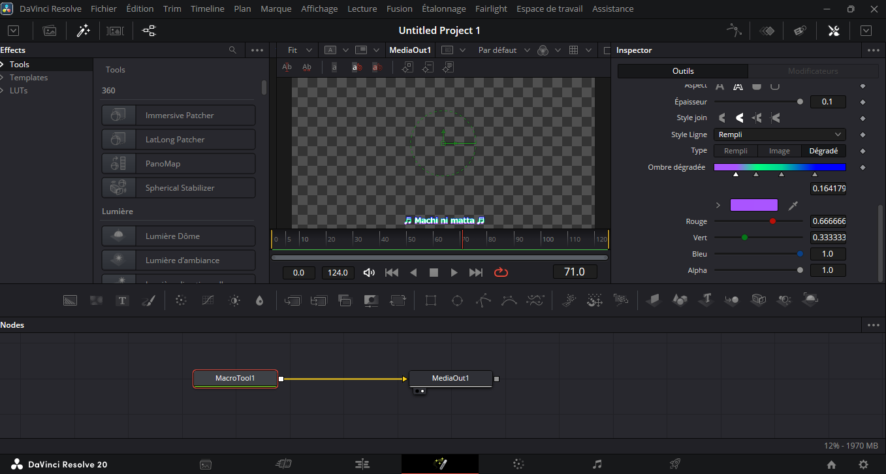

# dosnSRT TO TEXT+

Telecharge le zip sur le github de **https://github.com/nakano000/Resolve_Script#%E7%9B%AE%E6%AC%A1**

Met le dans le bureau et à chaque fois que tu veux lancer davinci et que tu veux utiliser srt to text+,appuie dessus(りぞりぷと.exe)

Appuie sur ResolveLauncher

ESapace de travail->Console

Ensuite tu appuie sur le carré vert et tu fais un cliqué glissé sur la console

Ensuite ferme davinci et redémarre le toujours en appuyant sur りぞりぷと.exe

Espace de travail->Scripts_>RS->Subtitle2TextPlus

# Important:

Tu ne places jamais ton text+ sur  video1 ,ca marche que sur video2 et ..

* Par exemple j'ai créé un projet vide et j'ai editer un text+(j'ai fait un dégradé) =>Si tu veux reutiliser le même text+ dans un autre projet suis ces etapes:

  ## Méthode 1 (+ simple)

  
* ## Méthode 2
* 
* 

  Ici 2 car j'ai selectionne le type 2 dans shading quand je faisais mon degradé(Red outline par defaut)

  

Créer ton dossier personel dans **Templates**.Par exemple ,le mien je l'ai nommé **Dégradé**

Va dans Fusion=>clic-droit sur Templates=>Créer une macro

Ensuite selectionne tout ce que tu as utilisé pour effectuer ton Text+ e si tu veux pas t'en péocuppé coche tout

Moi pour mon degradé j'ai utilisé **Text** et **Shading** (fais screen de tes truc que tu modifie dans text+ avec ton phone ca peut etre utile)

appuie sur les 3 points du coin supérieur gauche de l'editeur de macro =>enregistrer sous dans **C:\Users\babak\AppData\Roaming\Blackmagic Design\DaVinci Resolve\Support\Fusion\Templates\Edit\Titles\Dégradé**

J'ai nommé mon setting par exemple: **Rom Showdown.setting** utilisant 3 couleur pour mon degradé

Tu pourras utilise ce setting comme base pour d'autres dégradé

