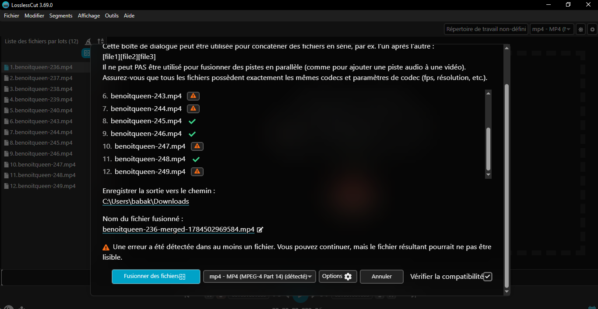

VA dans les favoris de mon google babakar.syr@gmail.com->>Snapchat

...

Télécharge les videos snapchat et va lire cours_ffmpeg_vfr.pdf





Exécuter le fichier powershell:

C'est très simple, il y a deux façons de faire selon ce que tu préfères : la méthode rapide directement dans ta console ouverte, ou la méthode "double-clic" classique.

Voici comment faire :

### Option 1 : Directement depuis ta console PowerShell actuelle (Recommandé)

Puisque tu as déjà ta console ouverte dans le bon dossier (`C:\Users\babak\Downloads`), il te suffit de taper ceci et d'appuyer sur **Entrée** :

```powershell
.\fusionner_clips.ps1
```

> ⚠️ **Si Windows affiche un message d'erreur rouge** (sécurité des scripts) :
> C'est une sécurité par défaut de Windows. Pas de panique, lance cette commande pour l'autoriser juste pour cette fois, puis réessaye :
>
> ```powershell
> Set-ExecutionPolicy -ExecutionPolicy Bypass -Scope Process
> .\fusionner_clips.ps1
> ```

---

### Option 2 : Depuis l'explorateur de fichiers de Windows

Si tu préfères ne pas taper de commande :

1. Ouvre ton dossier **Téléchargements** (Downloads).
2. Fais un **clic droit** sur le fichier `fusionner_clips.ps1`.
3. Choisis **"Exécuter avec PowerShell"** (Run with PowerShell).

Une fenêtre bleue ou noire va s'ouvrir, afficher la barre de progression pour la normalisation de tes 132 vidéos, et se fermer automatiquement une fois que le fichier `video_finale.mp4` sera prêt !
